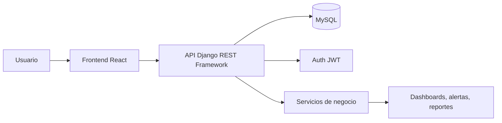

# Arquitectura de BOXTRACK

## 1. Objetivo
BoxTrack propone una plataforma para clubes y academias de boxeo con foco en la gestión administrativa y el seguimiento deportivo. La solución prioriza indicadores útiles para entrenadores, administradores y deportistas, en vez de una simple administración de gimnasios.

## 2. Arquitectura general

## 3. Capa frontend

- React + Vite
- Rutas protegidas por rol
- Componentes reutilizables para cards, tables, forms y charts
- Diseño mobile-first con menú lateral en desktop
- Configuración de perfil, apodo visible, privacidad del teléfono y tema claro/oscuro
- Recharts para estadísticas y evolución deportiva
- Lucide para iconografía
- Axios para consumo de API
- Páginas: login, dashboard, deportistas, competidores, entrenadores, clases y cupos, peleas, asistencia, alertas, notificaciones, tienda, membresías, configuración y panel de administración global (solo superusuario)
- En la web, el superusuario inicia en un panel global de consulta con indicadores, distribuciones por verificación y rol, directorios paginados y búsqueda de gimnasios y usuarios, además de la revisión de clubes, configuración personal y cierre de sesión. Las pantallas de gestión de un club quedan para sus propias cuentas.
- Pruebas focalizadas de navegación web: `node --test tests/global-admin.test.js` desde `frontend/`.
- Membresías (`MembershipsPage`): el administrador crea y edita planes y confirma o rechaza pagos; el deportista ve los planes de su club, solicita uno y consulta el estado e historial de su membresía
- Carrito de la tienda: se guarda por usuario en el navegador (no se comparte entre cuentas), se sincroniza con el catálogo real al cargar (precio, stock e imagen vigentes; se retiran productos inactivos o agotados), permite vaciarlo con confirmación y muestra la imagen del producto. El total definitivo y el stock siempre los valida el backend al crear el pedido
- La agenda de clases (`TrainingPage`) se refresca sola cada 15 segundos y al volver a la pestaña o ventana, para que los deportistas vean de inmediato las clases nuevas que programa el administrador
- Membresía obligatoria (`MembershipsPage` y `TrainingPage`): el administrador activa o desactiva "Exigir membresía activa para reservar clases" con un selector (Activado/Desactivado) que guarda y persiste por club. Con la opción activa, el botón de reservar queda deshabilitado para quien no tiene membresía vigente y se muestra un mensaje con el enlace "Ver planes disponibles" (`/memberships`); si la membresía está pendiente de pago, el mensaje lo indica. El backend vuelve a validar (409 `MEMBERSHIP_REQUIRED`)
- Competidores y combates (`CompetitionPage`, ruta `/competition`, menú "Combates entre clubes" con icono de apretón de manos; "Historial de combates" conserva el de espadas). El entrenador solicita el paso de un deportista a competidor; el administrador aprueba o rechaza con una nota escrita en la misma pantalla (sin `prompt()` ni `confirm()`, que no funcionan bien en móviles ni en navegadores integrados). Los combates se proponen eligiendo un competidor propio y uno del directorio de otros clubes; el club rival acepta o rechaza, el club proponente solo puede cancelar. El resultado se registra con botones "¿Quién ganó?" (ganador o empate) y la cancelación pide confirmación en línea. El deportista solo consulta
- Avisos: `.notice-success` es verde (claro y oscuro) y `.notice-error` rojo; la regla antigua que pintaba los éxitos de rosado se eliminó
- Validación visual (navegador, 390/768/1280 px): sin desbordamiento horizontal en membresías, clases y combates

### Aplicación móvil (`mobile/`)
- Expo SDK 58 + React Native, independiente del frontend web. Consume la misma API DRF/JWT: no tiene base de datos ni reglas de negocio propias (el backend valida permisos, cupos, membresía obligatoria y aislamiento por club).
- Estructura: `src/api` (cliente con refresh de token, errores y timeout), `src/auth` (sesión en SecureStore), `src/cart` (carrito por usuario, sin precios), `src/screens`, `src/components`, `src/navigation` (pestañas Inicio/Clases/Membresías/Más según rol), `src/utils` (reglas puras probadas).
- Pantallas: inicio, perfil, club, notificaciones, clases y reservas, membresías (deportista y administrador), combates entre clubes, tienda/carrito/pedidos con comprobante de transferencia.
- URL de API: `EXPO_PUBLIC_API_URL` → IP LAN del bundler → `10.0.2.2` (emulador Android) → `localhost`. Para teléfonos físicos el backend debe correr en `0.0.0.0:8000` con `ALLOWED_HOSTS` incluyendo la IP del PC. Instrucciones completas en `mobile/README.md`.
- Pagos: la app nunca marca pagos como aprobados. Si `GET /memberships/settings/` informa `mercado_pago_available`, el plan se compra con `POST /memberships/payments/` y se abre el `checkout_url` con `expo-web-browser`; al volver a la app (o a la pantalla) se consulta el estado real del pago. La membresía se activa solo cuando el backend recibe el webhook verificado. No validado en dispositivo ni con Mercado Pago real.
- Verificación: 39 pruebas Jest, bundle Android compilado y flujos probados en Expo web contra el backend (reserva, membresía obligatoria, combates entre clubes, compra con comprobante y aprobación). No se ha probado en emulador ni dispositivo nativo.

## 4. Capa backend

- Django como framework principal
- DRF para endpoints REST
- JWT para sesión y autenticación
- Modelos por dominio para aislar responsabilidades
- Permisos por club y por rol
- Validaciones en servidor y middlewares de seguridad
- Preferencias de perfil servidas por `GET/PATCH /api/auth/profile/`; el teléfono se oculta en las fichas de otros miembros cuando su dueño desactiva el uso compartido
- Módulos (`backend/apps`): `accounts`, `clubs`, `athletes`, `trainers`, `groups`, `trainings`, `attendance`, `evaluations`, `weight_tracking`, `competitions`, `alerts`, `notifications`, `dashboard`, `reports`, `store` y `common` (permisos compartidos)
- Endpoints de cuentas: `register/`, `login/`, `refresh/`, `me/`, `profile/`, `members/` (alta de cuentas del club por el admin) y `password/` (cambio de contraseña, incluido el obligatorio en el primer ingreso)
- Panel global: `GET /api/dashboard/global/`, `/api/dashboard/global/clubs/` y `/api/dashboard/global/users/` solo admiten superusuarios. Los directorios son de lectura, están paginados y admiten `search`; exponen únicamente los campos necesarios para el panel. Los totales incluyen cuentas y gimnasios inactivos; «activos» indica `is_active`, no aprobación del gimnasio.
- Verificación de clubes: al registrarse, un club queda `PENDING` hasta subir su documento (`/api/clubs/<id>/document/`), pasa a `IN_REVIEW` y un superusuario lo aprueba o rechaza (`/api/clubs/pending/`, `/api/clubs/<id>/review/`). Los estados son `PENDING`, `IN_REVIEW`, `NEEDS_INFO` y `APPROVED`. El documento se guarda en almacenamiento privado
- La cola de revisión incluye clubes `PENDING` e `IN_REVIEW`, para que el envío de documentación no los haga desaparecer del panel; la aprobación o rechazo conserva las reglas del endpoint existente.
- Disciplinas: los clubes nuevos se registran únicamente con `Boxeo`, asignado también a su administrador; el servidor rechaza otras disciplinas en el alta. Las disciplinas de clubes existentes no se modifican. Para crear una cuenta de deportista o entrenador se asigna automáticamente la única disciplina del club o se exige elegir entre sus disciplinas; el servidor valida la elección. Si el club no tiene ninguna, se bloquea el alta y su administrador puede configurar `Boxeo` desde Ajustes mediante `POST /api/clubs/discipline/initialize/`, que no sobrescribe disciplinas existentes.
- La disciplina elegida se guarda por usuario y aparece en su perfil web y móvil. Las cuentas antiguas sin asignación conservan sus datos: si su club tiene una sola disciplina se muestra como predeterminada, y si tiene varias pueden seleccionar una desde su perfil. Se aplica la migración aditiva `accounts.0005_user_discipline`.
- Cada registro crea un club y su administrador en una operación atómica. Los usuarios, planes y datos se vinculan al `club_id` propio; otro club no altera ni hereda sus registros. El RUT de empresa único evita registrar dos veces la misma entidad legal.
- Mientras el club no está aprobado, el administrador puede crear grupos y clases, pero entrenadores y el resto de módulos quedan restringidos. Excepción: los deportistas de un club activo pueden **consultar** las clases (solo lectura) aunque el club esté pendiente, de modo que ven la agenda que el admin programó
- Tienda: productos, pedidos, comprobantes de pago (subida, descarga y revisión por el admin: `NOT_SUBMITTED`, en revisión, aprobado o rechazado) y webhook de MercadoPago
- Membresías por club (`apps.memberships`, API en `/api/memberships/`):
    - `MembershipPlan` (`planes_membresia`): cada club crea y edita sus propios planes (nombre, precio, moneda, duración en días, beneficios, límite de clases semanales opcional, activo/inactivo). El nombre es único dentro del club.
    - `Membership` (`membresias`): contratación de un deportista. Guarda una instantánea del plan (nombre, precio, duración, límite) para que editar el plan no altere lo ya contratado. Estados: `PENDING`, `ACTIVE`, `EXPIRED`, `REJECTED`, `CANCELLED`. Una restricción en base de datos impide tener más de una membresía `PENDING` o `ACTIVE` por deportista.
    - Flujo: el deportista solicita un plan (`POST /api/memberships/`) y queda `PENDING`; el administrador confirma el pago, rechaza con motivo o cancela (`POST /api/memberships/<id>/review/` con `decision` = `CONFIRM`, `REJECT` o `CANCEL`). Al confirmar se fijan las fechas de inicio y fin y se notifica al deportista. El deportista solo puede cancelar su propia solicitud pendiente.
    - El precio y el club salen siempre del servidor; el cliente solo envía el id del plan. Las membresías vencidas pasan a `EXPIRED` al consultarse, sin depender de tareas programadas.
    - Límite semanal en reservas: si el deportista tiene una membresía `ACTIVE` con `weekly_class_limit`, el servidor rechaza (409) una reserva que supere ese número de clases `RESERVED` en la misma semana (lunes a domingo) de la fecha de la clase. Cancelar una reserva libera el cupo semanal. Sin membresía, con plan sin límite o con membresía vencida, las reservas funcionan como antes, para no romper clubes que aún no usan planes. Aplica tanto a reservas del deportista como a inscripciones hechas por el equipo.
    - Exigir membresía para reservar (por club): `MembershipSettings` (`configuracion_membresias`, un registro por club, `require_active_membership`, desactivado por defecto). `GET/PATCH /api/memberships/settings/` (leer: cualquier rol del club; cambiar: solo ADMIN). Si está activado, el servidor responde 409 con `code: MEMBERSHIP_REQUIRED` a quien reserve sin membresía `ACTIVE` vigente en la fecha de la clase (o con una pendiente de pago/vencida), antes de revisar el límite semanal. El frontend (`TrainingPage`) deshabilita el botón y muestra el enlace "Ver planes disponibles", pero la validación real está en el backend. El interruptor está en la página Membresías del admin. Con la opción apagada nada cambia, y cada club tiene su propio valor.
    - Pago manual: el administrador del club confirma o rechaza la solicitud (`POST /memberships/<id>/review/`). Sigue funcionando igual y es la alternativa cuando el club no tiene Mercado Pago.
    - **Pago online con Mercado Pago (P2)** — `apps/memberships/payments.py`, modelo `MembershipPayment` (`pagos_membresia`: usuario, club, plan, membresía, monto y moneda como instantánea del plan, estado, `provider_payment_id` único, expiración):
        - Reutiliza la integración de la tienda (`apps/store/views.py`): mismas variables de entorno, `post_mercadopago_preference`, `webhook_signature_valid` (HMAC-SHA256 de `x-signature`) y `fetch_mercadopago_payment` (consulta del pago a la API oficial). No hay una segunda integración ni un segundo webhook: `/api/store/payments/mercadopago/webhook/` delega según el `external_reference` (`membership:<id>` → membresías; número → pedido de tienda, sin cambios).
        - Endpoints (solo ADMIN/ATHLETE del club): `POST /memberships/payments/` (solo ATHLETE; `{plan}`), `GET /memberships/payments/` (deportista: los suyos; admin: los del club), `GET /memberships/payments/<id>/` y `DELETE` (el comprador cancela su pago pendiente). `GET /memberships/settings/` añade `mercado_pago_available`. Ningún endpoint permite marcar un pago como aprobado.
        - Flujo: el servidor toma plan, precio, moneda y duración de la base de datos (ignora importes del cliente), crea la membresía `PENDING` y el pago `PENDING` (30 min), genera la preferencia y devuelve `checkout_url` (solo al comprador). Una compra abierta del mismo plan se reutiliza (no hay doble cobro); con otra membresía abierta o una solicitud manual pendiente responde 409. Si Mercado Pago falla, la compra se cancela y no se cobra.
        - Confirmación: el retorno del checkout (`?payment=success`) no aprueba nada. Solo el webhook firmado, cuyo pago se vuelve a consultar a la API de Mercado Pago, cambia el estado. `approved` activa la membresía si monto y moneda coinciden con lo registrado (400 si no). Es idempotente: repetir el webhook no reactiva ni duplica; el `provider_payment_id` es único y un segundo cobro aprobado para la misma compra se registra y avisa al administrador sin aplicarse.
        - Estados del pago: `PENDING`, `APPROVED`, `REJECTED` y `CANCELLED` (la membresía se cancela y el deportista puede reintentar), `EXPIRED` (al vencer el checkout), `REFUNDED` (reembolso o contracargo: cancela la membresía) y `REVIEW` (cobro aprobado que llegó tarde y no pudo activarse porque hay otra membresía abierta: avisa al administrador). Un pago aprobado que llega tras rechazo, cancelación o vencimiento reactiva la membresía si el deportista no tiene otra abierta.
        - Cambios del plan: desactivarlo o cambiar su precio después de iniciar la compra no altera lo ya registrado; la membresía conserva la instantánea de precio y condiciones.
        - Preparado para renovaciones (P3): cada pago referencia su membresía y plan y los registros anteriores se conservan; aún no hay renovación ni cobros recurrentes.
        - Configuración necesaria: `MERCADOPAGO_ACCESS_TOKEN`, `MERCADOPAGO_WEBHOOK_SECRET`, `MERCADOPAGO_NOTIFICATION_URL` (URL pública del webhook) y `FRONTEND_URL` para las `back_urls`. Sin ellas `mercado_pago_available` es `false`, las pantallas ocultan el botón y el endpoint responde 503; nunca se simula un cobro.
        - Errores del proveedor: si Mercado Pago no responde, excede el tiempo de espera o devuelve un cuerpo inesperado (no es un objeto JSON), el webhook responde 502 sin modificar ningún pago, membresía ni pedido, para que Mercado Pago reintente.
        - Tipos de notificación: el webhook solo consulta notificaciones de tipo `payment` (o sin tipo). Las de otro tipo, p. ej. `merchant_order` (indicado en el cuerpo `type`/`topic` o en la consulta `type`/`topic`), se responden 200 con `ignored` tras validar la firma, sin consultar al proveedor, sin tratar su id como id de pago y sin cambiar estados; así no hay reintentos inútiles. Una firma inválida sigue dando 401. La aprobación siempre llega por la notificación `payment`. Para evitar ruido, en el panel de Mercado Pago basta suscribir el evento «Pagos».
        - Niveles de prueba: (1) pruebas automatizadas Django/Jest con el proveedor simulado (`mock`), que verifican nuestra lógica pero no la respuesta real de Mercado Pago; (2) pruebas con proveedor simulado en el navegador, con tokens de marcador (la API real rechaza el token y se comprueba el camino de error); (3) validación real con sandbox de Mercado Pago, **aún no realizada**.
        - Requisitos para declarar P2 completamente validada: credenciales de prueba (`TEST-…`), URL HTTPS pública del webhook, compra con un comprador y tarjetas de prueba verificando firma y monto reales, rechazo y pendiente, y una prueba del checkout y del refresco al volver en un dispositivo o emulador Android nativo.
        - Pruebas: `apps/memberships/test_payments.py` (proveedor simulado; no hay llamadas reales). **No se ha validado con credenciales reales ni con el sandbox de Mercado Pago.**

- Competidores y combates entre clubes (`apps.competitions`, `apps/competitions/inter_club.py`, página `/competition`):
    - `CompetitorRequest` (`solicitudes_competidor`): el entrenador (solo de deportistas asignados a él) solicita el paso a competidor (`POST /api/competitions/competitor-requests/`); el ADMIN del mismo club resuelve (`POST .../<id>/review/` con `decision` `APPROVE` o `REJECT` y `review_note`). Al aprobar solo se marca `is_competitor` en el mismo deportista (no se crea otra cuenta, sigue en la lista general con su filtro). Una restricción impide dos solicitudes pendientes del mismo deportista. Se notifica a admins, entrenador y deportista y el historial de solicitudes se conserva.
    - `FightMatch` (`combates_entre_clubes`): un único registro por combate, visible para ambos clubes y ambos competidores. Estados `PROPOSED`, `ACCEPTED`, `DECLINED`, `CANCELLED`, `COMPLETED`. Endpoints: `GET/POST /api/competitions/matches/`, `POST /api/competitions/matches/<id>/<accept|decline|cancel|result>/`, `GET /api/competitions/directory/` (competidores activos de otros clubes aprobados; solo nombre, club, categoría y peso).
    - Reglas: propone el staff del club del retador (el entrenador solo con sus asignados); ambos deben ser competidores activos de clubes distintos y el club rival debe estar aprobado; no se permiten fechas pasadas ni dos combates abiertos del mismo deportista en una fecha. Acepta o rechaza el staff del club rival; cualquiera de los dos clubes registra el resultado una sola vez (desde la fecha del combate) y se crean los registros `Competition` de cada club (resultado e inverso) para actualizar el récord. El deportista ve sus combates pero no puede modificarlos.

## 5. Base de datos

- MySQL 8.0+
- Modelo relacional normalizado
- Relación obligatoria entre usuarios, clubes y roles
- Aislamiento por club para evitar fuga de información
- Índices sobre búsquedas frecuentes y relaciones clave
- Las tablas y columnas de negocio usan nombres físicos en español en SQLite y MySQL; los nombres internos de Django se conservan para no romper autenticación y permisos.

### Tablas de negocio en DB Browser

| Área | Tablas |
| --- | --- |
| Cuentas y clubes | `roles`, `usuarios`, `clubes` |
| Plantel | `deportistas`, `perfiles_entrenadores`, `grupos` |
| Clases y seguimiento | `clases`, `reservas_clases`, `asistencias`, `evaluaciones`, `registros_peso`, `competencias`, `alertas`, `notificaciones` |
| Tienda | `configuracion_tienda`, `productos`, `pedidos`, `detalle_pedidos` |
| Membresías | `planes_membresia`, `membresias`, `pagos_membresia` |

Las columnas también se guardan en español, por ejemplo `usuarios.nombre_usuario`, `deportistas.fecha_nacimiento`, `clases.fecha_programada` y `pedidos.estado`. En las relaciones, `id_club`, `id_deportista` e `id_usuario` identifican claves foráneas. `id` se mantiene como identificador primario.

Las tablas de infraestructura como `django_migrations`, `django_content_type`, las tablas de sesiones/permisos y las tablas intermedias de permisos de usuario conservan sus nombres estándar de Django. No deben renombrarse ni editarse directamente. Para que el esquema quede actualizado, ejecutar `python manage.py migrate` antes de abrir o volver a cargar `backend/db.sqlite3` en DB Browser.

## 6. Modelos esperados

### Entidades principales
- Club
- Usuario
- Perfil de usuario
- Rol
- Permiso
- Deportista
- Perfil de competidor, con grupo de preparación diferenciado y récord derivado del historial de combates
- Entrenador
- Grupo
- Entrenamiento / clase programada, con capacidad máxima
- Reserva de cupo del deportista en una clase
- Asistencia
- Evaluación deportiva
- Registro de peso
- Competencia
- Resultado de combate
- Alerta
- Notificación
- Objetivo deportivo

## 7. Seguridad

- JWT con tokens de acceso y refresh
- Control de acceso por roles: administrador, entrenador, deportista
- Matriz de permisos:
    - Administrador: crea cuentas, administra perfiles y grupos, programa clases y gestiona la configuración del club.
    - Entrenador: consulta deportistas y grupos; programa clases, registra asistencia y mantiene el seguimiento deportivo y alertas. No administra cuentas ni perfiles del equipo.
    - Deportista: consulta clases, reserva o cancela sus propios cupos y consulta sus notificaciones.
- Los permisos se validan en la API; ocultar una opción en el frontend no sustituye la autorización del backend.
- Validación que un club no acceda a otra base de datos
- Protección de rutas en frontend y backend
- Privacidad del teléfono configurable por usuario; el propio usuario y los administradores de su club pueden verlo
- El apodo solo reemplaza el nombre visible cuando el usuario activa esa preferencia; se conservan los nombres legales en la ficha
- Auditoría de acciones relevantes
- Visibilidad de clases: un deportista solo ve clases de su club que no tienen grupo o que pertenecen a su mismo grupo; un entrenador solo ve y gestiona las clases asignadas a él
- Los documentos de verificación del club y los comprobantes de pago se almacenan fuera de las rutas públicas

## 8. Plan de desarrollo recomendado

### Etapa 1: base
- Inicializar proyecto Django
- Configurar settings y base de datos
- Definir auth y roles
- Crear migraciones base

### Etapa 2: entidades de negocio
- Clubes, usuarios, deportistas y entrenadores
- Asignaciones y perfiles de usuario

### Etapa 3: entrenamiento y asistencia
- Grupos, actividades, clases disponibles y calendario
- Reserva y cancelación de cupos por deportistas, respetando la capacidad de cada clase
- Registro de asistencia efectiva por parte del entrenador; reservar un cupo no equivale a asistir
- Evitar reservas duplicadas y sobrepasar la capacidad de una clase

### Etapa 4: seguimiento deportivo
- Plantel general y equipo de competidores, evaluaciones, récord de peleas, historial de peso y evolución

### Etapa 5: tienda del gimnasio
- Catálogo y stock por club
- Carrito, pedidos y estado de pago/entrega
- Checkout integrado con proveedor de pago configurado y confirmación por webhook

### Etapa 5: analítica y alertas
- Dashboard, análisis rule-based y notificaciones internas

### Etapa 6: reportes y pruebas
- Exportación, reportes y test suite

### Etapa 7: UX y despliegue
- Responsive design, PWA, documentación y preparación de despliegue

## 9. Decisiones clave

- Se usarán módulos por dominio para mantener la escalabilidad y facilitar la defensa del proyecto.
- La gestión de usuarios y clubes se resolverá con una estructura de autorización robusta desde el backend.
- Cada entidad vinculada a un club deberá incluir una referencia explícita al club para garantizar aislamiento de datos.
- Los dashboards y alertas se construirán desde datos reales, nunca valores artificiales.

## 10. Lineamientos de mejora y estado (prompt maestro)

Reglas de trabajo: conservar el proyecto existente (no recrear módulos, no borrar datos, migraciones compatibles), validar permisos y precios siempre en el backend, aislar los datos por club y no declarar terminada una función sin probarla.

| Área | Estado | Detalle |
| --- | --- | --- |
| Membresías y planes por club | Implementado | Planes por club, compra manual y online, historial, renovaciones anticipadas y vencidas, vigencia programada, notificaciones y límite semanal en reservas. Opción por club "Exigir membresía activa para reservar clases" (desactivada por defecto). No hay cobros recurrentes. |
| Pagos de membresías | Implementado, sin validar con Mercado Pago real | Compra online con webhook firmado, verificación contra la API, idempotencia y activación solo tras pago aprobado (33 pruebas con proveedor simulado), web y móvil. Falta probar en el sandbox de Mercado Pago con credenciales de prueba y una URL pública. Sin cobros recurrentes. |
| Tienda y carrito | Parcial | Backend ya valida stock, precios y vencimiento de reservas. Carrito del frontend corregido. Falta revisar visualmente imágenes/etiquetas en móvil y estado de entrega. |
| Clases y reservas | Parcial | Cupos, duplicados y visibilidad por grupo funcionan. Falta disciplinas, horarios recurrentes y lista de espera. El límite semanal del plan ya se aplica. |
| Deportista a competidor | Implementado (base) | El entrenador solicita, el admin del club aprueba o rechaza; queda registro y notificaciones. Pruebas incluidas. |
| Combates entre clubes | Implementado (base) | Propuesta, confirmación del club rival, cancelación y resultado en un único registro compartido; pruebas incluidas. Falta calendario público y ranking. |
| Registro de clubes | Parcial | Verificación con documento y estados existe. Falta RUT, responsable y selección visual de disciplinas con revisión administrativa explícita. |
| Notificaciones | Parcial | Internas existentes; membresías ya notifican. Faltan vencimientos próximos y estados de pedidos. |
| Aplicación móvil | En progreso | `mobile/` (Expo + React Native) con sesión, clases, reservas, membresías y renovaciones, combates y tienda; falta probar en dispositivo físico/emulador nativo y las herramientas del entrenador (asistencia, evaluaciones). |
| Responsive y UX | Pendiente de auditoría | Revisar tablas, modales y navegación en móvil. |

## 11. Actualización P3: renovaciones, avisos, Webpay y marca por club

La tabla de estado anterior registra la línea base del proyecto. Esta sección documenta la implementación P3 incorporada después de esa auditoría.

### Membresías y renovaciones

- `Membership` conserva cada contratación y enlaza renovaciones mediante `renewal_of`. Los registros y pagos anteriores no se sobrescriben. La API de membresías devuelve `club_name`, `days_remaining`, `payment_status` y `payment_provider` junto con el estado, precio y fechas.
- El administrador asigna desde `POST /api/memberships/` indicando el deportista y el plan del mismo club. La membresía queda visible para esa cuenta y para su entrenador asignado; no se copia una membresía al usuario ni al navegador.
- `GET/POST /api/memberships/renewal/` calcula y crea renovaciones. La ventana anticipada sigue siendo de 7 días. El deportista elige un plan y el backend toma su precio y duración.
- Una renovación anticipada aprobada queda `SCHEDULED` y comienza el día posterior al vencimiento de la membresía actual. Una renovación de una membresía vencida comienza el día en que se confirma el pago. La fecha final sigue la convención existente del sistema: inicio más duración y vigente hasta el día final inclusive.
- `PENDING` no se confirma manualmente si tiene un pago online; requiere el resultado verificado del proveedor. Las restricciones condicionales de una sola membresía `PENDING`, `ACTIVE` y `SCHEDULED` por deportista dependen del soporte del motor: SQLite las admite, MySQL no. No se ha validado la concurrencia real entre solicitudes, cancelaciones y confirmaciones; no debe considerarse garantizada en todos los motores.
- Si una renovación programada ya terminó antes de procesarse, se marca `EXPIRED`, sin volver a activarla. Al cancelar un pago pendiente se notifica al deportista. Las interfaces muestran los errores al consultar pagos o renovaciones en vez de presentar un historial vacío.
- Los entrenadores consultan las membresías y el estado resumido del pago de deportistas asignados a ellos. Solo el deportista comprador y el administrador del club consultan el detalle del pago; el enlace de checkout solo se entrega al comprador.

### Avisos de vencimiento

- `MembershipExpirationNotice` registra de forma única los avisos `DAYS_7`, `DAYS_3`, `DAY_1` y `EXPIRED`; cada aviso también se guarda en `Notification` para web y móvil.
- El comando `python manage.py send_membership_expiration_notifications` es repetible y utiliza la zona `America/Santiago`. Evita enviar al usuario de otra cuenta/club y deja de avisar por una membresía cuando ya existe una renovación activa o programada.
- Programar el comando una vez al día a las 08:00 en hora local con Windows Task Scheduler o cron. En Windows, usar `python.exe` como programa, `manage.py send_membership_expiration_notifications` como argumento y `backend/` como directorio de inicio. En Unix, ejecutar desde `backend/` con el intérprete del entorno virtual, por ejemplo `0 8 * * * /ruta/venv/bin/python manage.py send_membership_expiration_notifications`.
- Al tocar una notificación de membresía en móvil, o usar «Ver membresía / renovar» en web, se abre la pantalla de membresías.

### Combates entre clubes

- `GET /api/competitions/rival-clubs/` entrega clubes aprobados y activos distintos del club actual, incluso si aún no tienen competidores, e incluye su cantidad de competidores activos. Los clubes pendientes/inactivos no se exponen como rivales. Tras elegir el club, `GET /api/competitions/directory/?club=<id>` devuelve solo sus peleadores activos aprobados como competidores.
- La web y móvil cargan clubes y peleadores en pasos separados. `POST /api/competitions/matches/` exige `opponent_club`; el backend comprueba que coincide con el club real del deportista rival. Club retador, club rival, aceptación, cancelación, resultados e historiales siguen usando `FightMatch` existente.
- El directorio muestra clubes elegibles aunque todavía tengan cero competidores; la lista de boxeadores se filtra al club seleccionado. Cada club conserva sus miembros e historial propios.

### Transbank Webpay Plus de pruebas

- Transbank usa el SDK oficial `transbank-sdk` (`>=6.1.0,<7.0`) y Webpay Plus. La integración está limitada a `IntegrationType.TEST`; no habilita producción.
- Configurar en `.env`: `TRANSBANK_ENVIRONMENT=TEST`, `TRANSBANK_COMMERCE_CODE` y `TRANSBANK_API_KEY` con credenciales de integración de Transbank. El servidor nunca devuelve estas credenciales a clientes. El SDK inicia transacciones y la ruta `/api/store/payments/transbank/checkout/<token>/` envía el token a Webpay por POST.
- Transbank vuelve a `POST/GET /api/store/payments/transbank/return/`. El backend consulta el resultado con `Transaction.commit(token)` y contrasta token, monto, buy order y session ID antes de aprobar. Si falta el resultado o hay discrepancias, la membresía sigue pendiente o queda `REVIEW`; un pedido con cobro tardío o discrepante queda `PAYMENT_REVIEW` y genera aviso administrativo.
- Webpay sirve para membresías, renovaciones y pedidos de tienda. El checkout de Mercado Pago y su único webhook `/api/store/payments/mercadopago/webhook/` siguen en uso; transferencia, comprobante y retiro también se conservan.
- Con mocks se pueden probar creación y callback. No se afirma una transacción sandbox hasta configurar credenciales de prueba y completar un pago real de integración. No usar credenciales ni endpoints productivos en esta etapa. La futura activación de producción requiere una revisión separada de credenciales, URLs y ambiente.
- Referencias del proveedor: [SDK oficial Python](https://github.com/transbankdevelopers/transbank-sdk-python), [ejemplo Webpay Plus Python](https://proyecto-ejemplo-python.transbankdevelopers.cl/webpay-plus/) y [referencia oficial Webpay](https://github.com/TransbankDevelopers/transbank-developers-docs/blob/master/referencia/webpay/README.md).

### Personalización visual por club

- `Club` guarda `primary_color`, `accent_color` y el `logo` ya existente. Los campos de color aceptan hex `#RRGGBB`; la carga admite PNG, JPG o WebP hasta 2 MB y 5000 × 5000 píxeles.
- `GET/PATCH /api/clubs/branding/` solo permite al administrador guardar la marca de su propio club. `/api/auth/profile/` entrega el logo y colores dentro del club anidado, y `GET /api/clubs/` devuelve los mismos valores.
- Web aplica colores a botones, navegación y encabezado del club; móvil los aplica a botones, navegación y página «Mi club». Cuando no hay imagen se usa el distintivo predeterminado. El color del texto de los botones se calcula para conservar contraste.

### Migraciones y validación

- Migraciones aditivas: `clubs.0005_club_accent_color_club_primary_color`, `memberships.0005_membershippayment_payment_provider_and_more` y `store.0007_order_transbank_authorization_code_and_more`. No eliminan ni modifican filas históricas.
- Los mapeos físicos en español de columnas nuevas están declarados en `apps/common/models.py`.
- Suite focalizada de pagos y reglas: `python manage.py test apps.memberships apps.store apps.clubs apps.competitions`. Las pruebas de Transbank son automatizadas con mocks; no reemplazan una prueba real del ambiente de integración.

### Resultado de validación P3 (2026-10-29)

- `python manage.py test --verbosity 1`: 176 pruebas aprobadas en la ejecución final.
- `python manage.py makemigrations --check` y `python manage.py check`: sin cambios pendientes y sin errores de configuración.
- `npm run build` en `frontend/`: compilación Vite aprobada; Vite informó avisos de opciones de configuración obsoletas.
- `npm test -- --runInBand` en `mobile/`: 39 pruebas aprobadas.
- `npm run export` en `mobile/`: bundle Android de Expo exportado. Esto no equivale a generar un APK ni a probarlo en un emulador o dispositivo.
- La suite de Transbank usa mocks y verifica importes, estados, callbacks e idempotencia. No se completó una transacción real en el sandbox porque faltan credenciales configuradas.

### Seguimiento posterior de P3

- La pantalla móvil muestra renovaciones pendientes mientras la membresía vigente sigue activa, permite continuar o cancelar el pago y señala fechas de renovaciones programadas. El historial identifica cada renovación.
- El alta del club y su administrador se guarda atómicamente, y hay una prueba de registros consecutivos de dos clubes con administradores separados.
- La lista de clubes rivales está limitada intencionalmente a clubes activos y aprobados; no lista clubes pendientes ni expone sus boxeadores antes de la aprobación administrativa.
- Validación posterior: 182 pruebas Django con SQLite, 36 pruebas focalizadas de renovación, `makemigrations --check --dry-run`, build web, 39 pruebas Jest y exportación del bundle Android. Las pruebas de pagos usan proveedores simulados; no sustituyen una prueba de Mercado Pago sandbox ni una prueba móvil en dispositivo.
- Pendiente antes de considerar P3 lista para producción: garantizar y probar la concurrencia entre todos los caminos de compra, renovación, cancelación y confirmación usando el motor de base de datos de despliegue. En particular, el alta manual no bloquea la fila del deportista como el checkout online y MySQL no aplica las restricciones condicionales de unicidad.

## Empezar desde cero (reiniciar datos de desarrollo)

- Hacer una copia de `backend/db.sqlite3` y luego, en `backend`, ejecutar `python manage.py flush --no-input`. Esto borra usuarios, clubes, deportistas, clases, etc.; los roles se vuelven a crear solos al registrar un club.
- Registrar un club desde la pantalla de registro (queda `PENDING`) y crear un superusuario con `python manage.py createsuperuser` para aprobar clubes desde el panel de administración global.
- Los archivos `db.sqlite3.bak-*` son respaldos locales y no deberían subirse a Git.

## Correr codigo

- Terminal Frontend
    - cd /d C:\Users\renat\Desktop\Boxtrack\Boxtrack\frontend
    - npm install
    - npm run dev

- Terminal Backend
    - cd /d C:\Users\renat\Desktop\Boxtrack\Boxtrack\backend
    - python manage.py migrate
    - python manage.py runserver

## Subir a Github

- git add .
- git commit -m "nombre de commit"
- git push

## Correr en otra pc

- Instalar Git, Python 3.11–3.12 y Node.js 20.19+ o 22.12+. Después, abrir PowerShell
-   git clone <https://github.com/RenatoCielo/BoxTrack.git>
    cd Boxtrack
    Copy-Item .env.example .env

Para desarrollo local se usa SQLite por defecto. Para conectarse a MySQL, configura sus credenciales en `.env` y establece `USE_SQLITE_FALLBACK=False`.

En una terminal para el backend:

    cd backend
    py -3.12 -m venv .venv
    .\.venv\Scripts\Activate.ps1
    python -m pip install --upgrade pip
    pip install -r requirements.txt
    python manage.py migrate
    python manage.py runserver

En otra terminal, desde la carpeta raíz del proyecto:

    cd frontend
    npm install
    npm run dev
